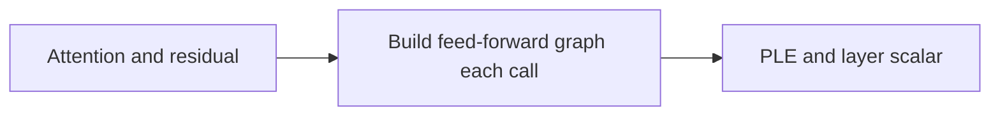
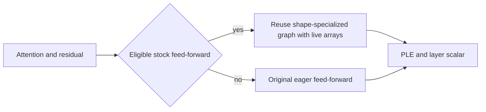

# Gemma 4 compiled feed-forward dispatch

This change reuses a shape-specialized compiled graph for the existing Gemma 4
feed-forward expression. In a matched 8K-context, single-request Darkbloom HTTP
comparison, it improved the post-first-frame decode proxy by 2.5–3.2% over the
prior dense GeGLU and scoped command-buffer change. The two orderings measured
102.19 → 105.43 and 102.94 → 105.48 tokens/s. These are incremental, bounded
measurements; they do not establish a concurrency or other-chip speedup.

The change is stacked on [the prior dispatch change](../gemma4-lossless-dispatch-2026-10-25/README.md),
at SDK revision `a63b4c69b73f05ff3e08ed51d22bcbb60a2a1447`. Provider test builds
use Darkbloom `f9d1af3d0d3e1838974a5cfdff0a08142977b45e`, MLX Swift
`eedca444432296c52d02b2595564ada936131633` and MLX core
`ff4bb35b60c3aadafb9e0bd30b6180cef646fb1a`. The SDK base's subsequent documentation
repairs do not change the measured implementation. [receipt.json](receipt.json)
records implementation, test, artifact, harness and evidence hashes without local
paths, credentials, prompts or model weights.

## Execution boundary

Previously, each eligible decoder call rebuilt the token-local feed-forward
graph. The new holder compiles the unchanged body with its live parameter arrays
as explicit state, then reuses a trace specialized to the input shape. It keeps
the original three-dimensional input geometry, routing, quantized projections,
normalization, arithmetic order and output type.

Eligibility requires GPU execution, BF16 inputs, an evaluation-mode stock MoE
layer and supported affine quantized children. Expert banks use 4 bits and group
size 64; dense and router projections may use 4 or 8 bits with group size 64.
Sequence width is 1 or 2, batch size is 1–7, and `B * S * topK < 64` preserves
the existing unsorted-routing boundary. For the target's topK 8, S2 accepts
batches 1–3; B4/S2 and B8/S1 use the original path.

Scheduled expert prefill, CPU execution, training, adapters or custom projection
types, unsupported dtypes/quantization, fused expert layouts and component
diagnostics retain the eager path. The default follows the existing compiled
decode capability setting; `DARKBLOOM_GEMMA4_COMPILED_FEEDFORWARD=0` disables the
new holder. `MLX_COMPILED_DECODE=0` also disables it.

The holder does not expose a second Module parameter tree. Weak owner captures
avoid retaining the decoder. Explicit live arrays preserve direct updates and
checkpoint materialization; retained child identities detect replacement even
when shapes match. Retired traces are destroyed outside the holder lock to
preserve MLX evaluation-lock ordering. An unsupported replacement invalidates an
old trace rather than keeping its weight bank alive.

Attention, PLE, layer scalars, MTP acceptance/depth policy, admission, paged KV,
prefix caching and SSD writes remain outside the change. No NAX kernel, host-row
index activation, quantization or precision-mode change is included.

## Endpoint comparison

The target was `gemma-4-26b-qat-4bit`, revision `2026-06-08-r1`, on an M5 Max with
40 GPU cores and 128GB unified memory, macOS 27.0 build 26A428, AC Automatic.
Each A1/B2/B3/A4 leg started a fresh owned provider, warmed its exact corpus, then
waited for 30 seconds of nominal idle posture before each measured cohort.
The same two synthetic requests per leg reported 8,204 prompt tokens, 8,192
cached tokens and 256 completion tokens, with temperature 0 and seed 1729.
Natural adaptive MTP and exact acceptance stayed enabled in both arms.

| Ordering | Prior dispatch tok/s | With compiled FFN tok/s | Median paired gain |
|---|---:|---:|---:|
| A1 → B2 | 102.192 | 105.433 | 3.167% |
| A4 → B3 | 102.937 | 105.482 | 2.472% |

All two pairs qualified in both orderings, with exact observed outputs and
matched usage/cache coverage. Same-arm output controls also matched. The paired
A/A decode drift was +0.730%; B/B was +0.055%. No pooled estimate is asserted.
The metric is `(completion_tokens - 1) / (last generated SSE frame time - first
generated SSE frame time)`. It is an HTTP decode proxy, not engine token
timestamps: frame/token mapping and hidden control tokens are not exposed.
End-to-end and TTFT values remain in the receipt.

Process memory is reported separately from MLX allocation. First-use leg lifetime
physical-footprint maxima were about 20.05 GiB for A1 and 20.07 GiB for B2; later
warmed legs were about 17.53 GiB for A4 and 17.56 GiB for B3. Sampled RSS and all
four lifetime figures are retained in the receipt. These include loading and
prewarm, are not isolated FFN peaks, and do not establish a memory reduction.

## Exactness checks and limitations

The tiny-model integration suite passed 11 tests with this feature enabled and
11 with it disabled, with zero failures or skips. It covers native output bytes,
S1/S2 shape reuse, routing ties, input changes, boundary fallbacks, diagnostics,
live parameters, module replacement, checkpoint materialization and owner/child
lifetimes. Supported post-routing parameter gradients retain exact comparisons.
Input and router-scale differentiation retain the original unsupported
gather-index VJP error; the suite does not claim newly supported routed gradients.

The opt-in actual-checkpoint test passed 690 native-byte and trace-selection
comparisons across all 30 layers in 3.528 seconds. It loads the original packed
FFN tensors and validates their geometry/quantization. B1/S1, B2/S1, B4/S1,
B7/S1, B1/S2, B3/S2 and eager B4/S2 each use three input amplitudes, followed by
two nonzero-input tied-router checks per layer. It compares the original eager
reference and the compiled candidate without a numerical tolerance. Checkpoint
files remain read-only; the tied-router perturbation belongs to a discarded
in-memory fixture. This validates within-shape FFN behavior, not every complete
model trajectory.

The full C4 ABBA comparison was rejected: outputs differed in 7 of 8 same-arm
pairs for both A/A and B/B. Surviving rows are not used for a C4 speed claim. An
initial capability run passed all 12 functional checks but one reasoning case
had different output bytes and 298 rather than 344 completion tokens. Three
immediate same-provider repetitions matched the 344-token baseline exactly; a
subsequent full 12-case capability run also matched the baseline. Both the initial
variant and exact repeats remain in the receipt. Existing adaptive-MTP shape
variation is a possible cause, not an established attribution.

The capability corpus checks reasoning on/off, tools, structured outputs, images,
video and text interleave. It is a fixed smoke corpus, not a universal capability
or losslessness proof. No claim is made for cold prefill, other chips, complete
training, or clustering. Cluster integration must merge its separate projection
policies and qualify trace identity and execution modes; an SDK pin alone is
insufficient. The broader output-stability limitation remains visible for review.

## Reproduction and review status

Use Xcode tests with the source-matched staged Metal library. Select
`MLXLMTests/Gemma4CompiledFeedforwardTests` twice, with the FFN flag 1 and 0 in
the actual test process. Set `MLX_COMPILED_DECODE=1`. For the optional checkpoint
suite, select `MLXLMTests/Gemma4CheckpointFeedforwardTests`, set
`GEMMA4_FFN_CHECKPOINT_DIR` to a local copy of the specified original checkpoint,
`GEMMA4_FFN_CHECKPOINT_LAYERS=all`, and enable both compile flags. The checkpoint
test does not download weights; without the path it is explicitly disabled.
The recorded tests retained `MLX_ENABLE_TF32=1`, matching the measured artifact's
existing setting; this change does not alter it.

The five implementation/test files were copied from the validated isolated
checkout, then formatted with the installed Xcode 27 toolchain. The reviewed
delta contains only whitespace and one array trailing comma; the receipt maps
validated source hashes to the formatted sources. The test binaries were built
from the saved pre-format sources, not from these new file bytes. Strict lint
reported only two pre-existing uppercase locals outside the FFN change. The
CI-style formatting idempotence check passed: its second pass left all five
file hashes unchanged. Xcode 26 CI formatting remains pending.

All 11 required library DocC targets passed for this composed FFN branch, with
warnings as errors and four jobs per target, run sequentially against the
existing pinned dependency cache. This compiled the branch's symbol graphs;
it did not rebuild or repeat the numerical test binaries. Full-package CI
remains pending. Required post-test refactor reviews found no further production
or fixture rewrite warranted. The branch remains a draft for independent review.
