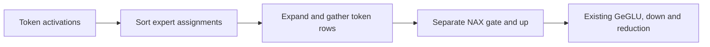
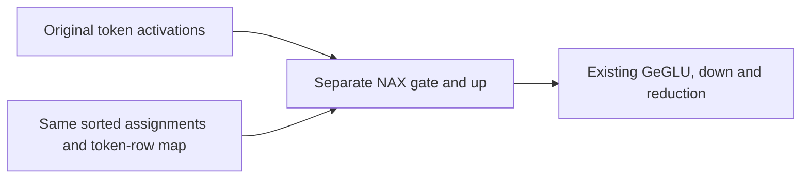

# Gemma4 row-mapped NAX prefill

Stock Gemma4 expert prefill expands and sorts token activations before separate gate/up products. This guarded route lets each NAX product read the original token row through the same sorted assignment map, avoiding the expanded activation staging. The two projection outputs remain independent; GeGLU, down projection, weighted reduction and all attention/cache operations retain their original expressions.

**The route is enabled automatically when every eligibility check below passes.** No environment setting is required. Set exact `DARKBLOOM_GEMMA4_NAX_ROW_MAP=0` before launching the process to restore the original route; `1` remains accepted. Other explicit values keep the original route, preserving their previous behavior. The setting is read once per process. Hardware, model, stream, shape and transformation guards are unchanged.

## Qualified scope

The route requires the exact stock `SwitchGLU` GeGLU profile in evaluation mode, H2816/F704/E128, BF16 activations, affine4/group64 expert banks, topK8 and 64–2048 production-prefill tokens. The down projection must retain the supported stock topology. It runs only on an available NAX device through the default GPU stream, with ordinary untraced arrays. Parameters and maps remain live graph inputs; no weight or parameter-identity cache is added.

CPU, custom streams, non-NAX devices, non-Metal builds, training, transformations, subclasses/adapters, other activations, quantizations and shapes keep the complete original graph. One-token tails and decode are outside this route. Both projection calls retain the original K16 MMA sequence, FP32 accumulators, BF16 dequantization and stores. There is no fused gate/up dispatch or changed activation epilogue.

The embedded Apple MLX source retains its copyright notices and [MIT permission notice](LICENSE-MLX-MIT). [Source provenance](source-provenance.json) records generated-input hashes, the address-only helper diff, and the tested-to-review source mapping. A formatter directive preserves the generated raw Metal header byte-for-byte.

## Cold endpoint evidence in both orders

Separate A-then-B and B-then-A screens completed on an M5 Max with 128GB memory, using the actual Darkbloom HTTP endpoint and `gemma-4-26b-qat-4bit`. These historical measurements used the same signed, default-off artifact: A left the option unset and B set it to 1. With the current automatic default, reproducing an OFF control requires explicit `DARKBLOOM_GEMMA4_NAX_ROW_MAP=0`. The original [receipt](receipt.json) and [source provenance](source-provenance.json) remain unchanged; they describe the measured artifact, not a new default-enabled benchmark. Each order and context has four independent fresh prompts, concurrency 1 and a 32-token completion limit. All 16 paired outputs/usage matched exactly and all requests reported zero cached prompt tokens. The corpus was not prewarmed. Standard warmup, serving policies, exact acceptance and full response completion were retained.

| Execution order | Raw prompt context | OFF median HTTP TTFT | ON median HTTP TTFT | Median paired OFF/ON ratio | Exact pairs |
|---|---|---:|---:|---:|---:|
| A then B | 4096 | 0.755157s | 0.703703s | 1.074204 | 4/4 |
| B then A | 4096 | 0.755701s | 0.703148s | 1.075412 | 4/4 |
| A then B | 8192 | 1.541439s | 1.450370s | 1.062207 | 4/4 |
| B then A | 8192 | 1.545412s | 1.450411s | 1.065660 | 4/4 |

TTFT includes request processing, prompt computation, scheduling and the first generated frame; it is not an isolated engine-prefill timer. The ratio is the median of per-request ratios, not the ratio of medians. Stable matching thermal/power snapshots qualified these pairs; snapshots do not prove continuous posture. Every raw pair is retained in the sanitized [receipt](receipt.json), including the first 4K OFF request at 0.809073s.

Both orders show about 6–7% lower HTTP TTFT for these uncached C1 prompts. This is a bounded prefill-facing endpoint result, not an isolated engine-prefill or decode result. **The same-app warm 8K C1/256-token regression control completed with exact outputs and essentially neutral decode proxies.** The 32-token decode proxy is not a new engine token-rate benchmark. Complete-response throughput ratios were 0.998677/1.004545 for 4K/8K in AB and 1.015775/1.021603 in BA; the full completion tail remains included, and this TTFT change does not imply a comparable end-to-end gain. Individual single-order qualification receipts retain their original limited scope; the two-order table does not erase that provenance.

## Warm decode regression control

A same-app OFF/ON ABBA control used two prewarmed 8K prompts, concurrency 1 and 256 completion tokens. Both A/B orderings and both same-arm repeats passed 2/2 exact pairs, with zero excluded rows and cached prompt tokens 8192. Forward OFF/ON median HTTP decode proxies were 113.738792/114.080594 tok/s; reverse medians were 113.863165/114.319036 tok/s. Median paired ratios were 1.002983 and 1.003994. These 0.3–0.4% differences are treated as a neutral regression control, with no attributed decode gain. The historical 105.5 tok/s result used a different paired baseline and conditions; its difference from 114 tok/s is not assigned to this route. All raw comparison rows, including the slightly slower forward pair, remain in the receipt.

## Exact native and capability evidence

The serving-specific native plans explicitly set `MLX_ENABLE_TF32=1`, matching the retained M5 serving/default posture. This does not change the separately configured CI policy, which sets `MLX_ENABLE_TF32=0`. The original-core native matrix passed nine synthetic contract tests in each OFF/ON process, plus 24 actual-checkpoint final-output comparisons and nine immutable banks in each mode. Four fresh full-model processes each recorded 1,915 native tensors/frontiers for fixed prefill and ordinary continuation cases: 64/B1,2048/B1,2049/B1 and 64/B4. The three comparison processes matched the OFF capture exactly. The B4 case prefills rows independently and then checks batched continuation; it is not a concurrency performance result.

Existing default-off profiler events identify 208 constructed row-map pairs per ON run versus zero OFF, followed by completed graph evaluation. The 208 pairs comprise five 64-token prefills across 30 layers and two 2048-token prefills across 29 layers; the existing final-layer prompt-tail narrowing excludes that layer from the longer chunks. These are graph-construction observations, not encoded GPU dispatch counters. Synthetic tests cover both reductions, live parameter updates and child replacement, exceptional/subset outputs, dropped wrappers and asynchronous lifetime, custom modules/streams, transformations and original error contracts. Broadcast-gradient nondeterminism is not recast as an exact guarantee.

All four HTTP capability suites passed 12 functional cases. The initial OFF reasoning case produced 298 tokens, exactly matching two historical variants; fresh ON and subsequent complete OFF/ON repeats matched the original 344-token output. The initial fresh OFF/ON exact comparison therefore failed for that one case and remains preserved. Three unchanged OFF repeats also matched 344. The route is disabled in OFF, and this 34-token prompt is below its 64-token minimum. First-use/controller-state variance is a hypothesis; these observations do not establish its cause. The warmed full-suite comparison was 12/12 exact. Native fixed-shape proof and capability smoke tests remain distinct from universal equivalence.

Initial test compiler errors and an OFF lifetime-fixture BF16-to-FP32 promotion were repaired only in tests and remain recorded. Five test processes emitted MLXProcessStreams QoS warnings; generated-code warnings were retained. No numerical assertion or tolerance was weakened.

## Review and portability limits

This branch starts at SDK 57ead88, retaining the previously reviewed GeGLU/command-buffer, compiled-FFN and greedy-metadata changes. The measured provider retains original Swift `eedca444` and core `ff4bb35`, with baseline Metal SHA 6ccc6296. The historical source mapping describes the original opt-in review. The subsequent automatic-default change alters only startup flag selection in the wrapper and permits an unset flag in the native contract test setup. `SwitchLayers`, every eligibility guard, the embedded Metal kernel and the full-model test are unchanged. Historical timings are not relabeled as measurements of the new revision.

Changed-file formatting is idempotent and independently reviewed. Fork coverage describes all 1,953 changed paths and the staged whitespace check passes; all 11 DocC targets passed with warnings treated as errors, using the exact 986-file review Libraries overlay and four jobs. The original review passed CI; the automatic-default revision requires its own checks. Positive NAX and real-checkpoint suites are explicit local opt-ins; ordinary CI compiles them but does not execute those positive paths without their environment and local assets.

No performance result is claimed for other chipsets, clustering, longer chunks or decode. Devices without NAX support keep the existing path. Clustering carries separate SDK projection changes; integration requires merging them and preserving stock-module, evaluation, stream and explicit-prefill contracts. A cluster SDK pin alone is insufficient, and its behavior/performance remains unmeasured. Paged attention, prefix caching, SSD writes, admission and MTP policies are unchanged.
